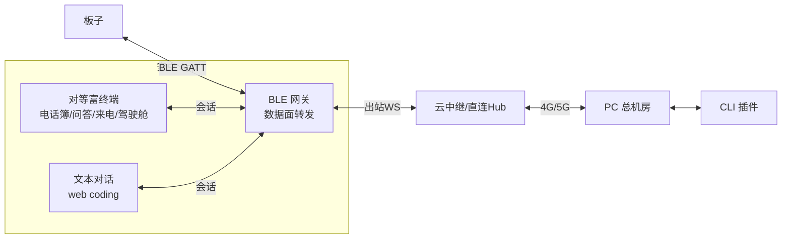
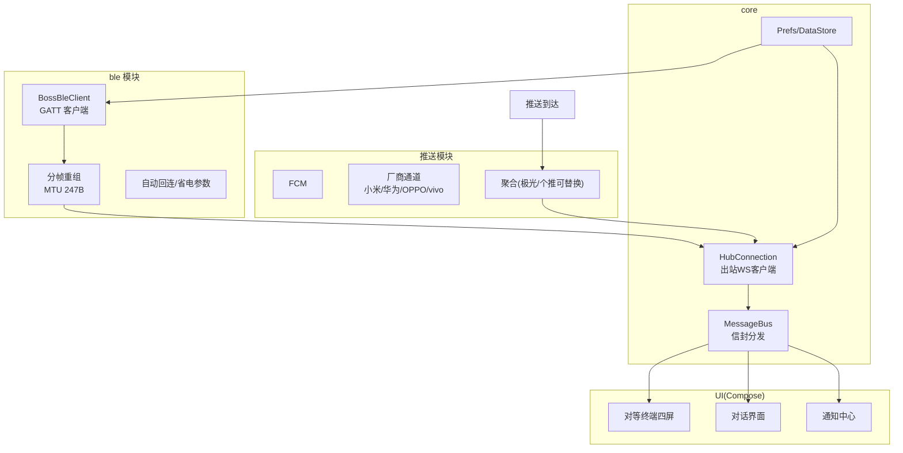
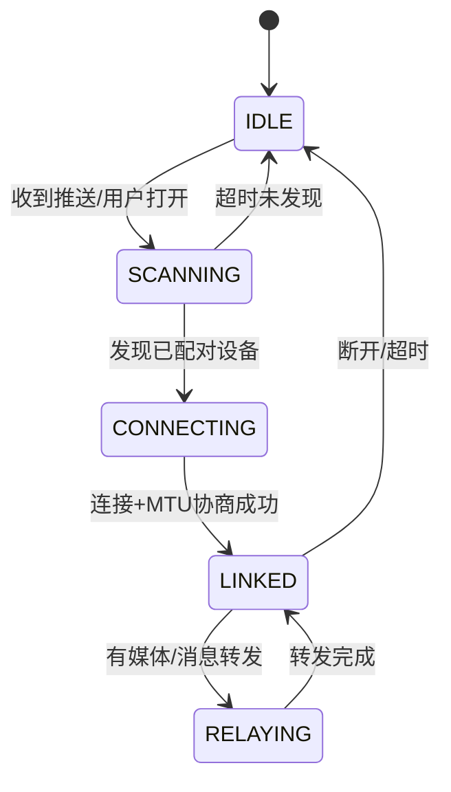
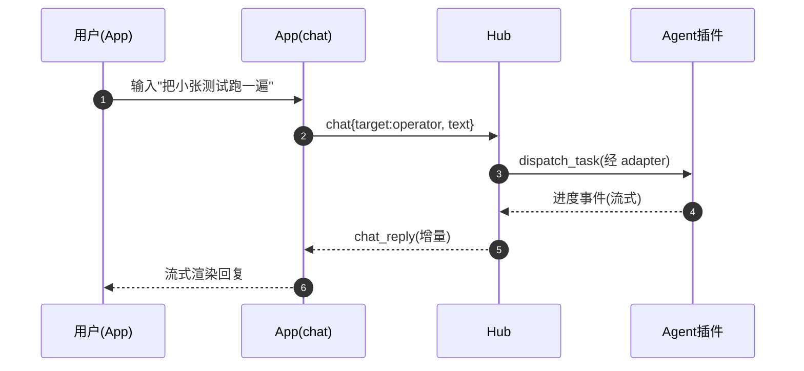

# BOSS PHONE 安卓 App 设计

| 项目 | 内容 |
|---|---|
| 状态 | Draft v0.1 |
| 上游 | [BOSS_PHONE_PRD.md](BOSS_PHONE_PRD.md) §3.2/§5.10/§4.3 · [DESIGN_OVERVIEW](BOSS_PHONE_DESIGN_OVERVIEW.md) §7.3 |
| 技术栈 | Kotlin + Jetpack Compose + 原生 BLE + kotlinx-serialization + Hilt |
| 日期 | 2026-08-24 |

App 的双重角色：**户外 BLE 口袋网关**（数据面，转发板子↔云中继）与**对等富终端**（web coding 客户端，与板子功能对等且更丰富）。

---

## 1. 双重角色



- **设备在局域网时**：App 不建 BLE、不收推送，**零负担**（PRD §4.3）。
- **设备离网时**：推送唤醒 App → 建 BLE 连接 → 成为数据面网关。

## 2. 模块划分



## 3. BLE 网关（数据面）

### 3.1 GATT 服务

| 元素 | 值 |
|---|---|
| 服务 UUID | `0000FFFF-0000-1000-8000-00805F9B34FB`（自定义） |
| RX 特征值（App 收） | `0000FFF1-...`，Notify |
| TX 特征值（App 发） | `0000FFF2-...`，Write with Response |

### 3.2 分帧与可靠传输（PROTOCOL §4.1 BLE 分支细化）

```
App→板子 TX：FRAG(2B seq)|FRAG(2B 分片号)|payload ≤247B
板子→App RX：同格式 Notify
ACK：板子对每帧回 ACK(seq)，超时重传；窗口=4 帧
```

- 连接参数：交互态 interval 15-30ms，空闲态 100-500ms（supervision 10s），兼顾跟手与省电。
- 配对绑定：`BOND_BONDING`；App 记录板子 MAC，重启后自动回连。

### 3.3 BLE 网关状态机



## 4. 推送接入

- **FCM 主通道** + 各厂商通道（小米/华为/OPPO/vivo），经聚合 SDK（极光/个推）或自实现厂商 SDK 双通道。
- **推送只唤醒，不承载业务数据**：payload 仅 `{op:"wake", hub:"relay"}`；App 唤醒后建 BLE + 出站 WS 拉取真实消息（安全 + 免厂商长度限制）。
- 厂商后台限制：引导用户加自启动/后台白名单（应用内引导页）。
- 零负担原则：设备在局域网时 Hub 不触发推送（路由决策见 DESIGN_HUB §3）。

## 5. 对等富终端 UI（Compose）

### 5.1 终端四屏（与板子同构）

| 屏 | 说明 |
|---|---|
| 电话簿 | 触摸列表替代三键；联系人=头像+名称+状态灯；首项总机 |
| 权限问答 | 单选/多选/输入；输入框直接键盘输入（FR-52，语音替代） |
| 来电/报警 | 全屏弹窗 + 本地通知 + 可后台响应 |
| 总览驾驶舱 | 四面板（Agent/Token/PC/CI），触摸切页 |

### 5.2 文本对话（web coding，FR-51）



- 对话支持：@联系人、代码块高亮、diff 折叠、错误信息粘贴解析。
- 与板子关系：同一 ask 双端可答，先答先得（PROTOCOL §8）。
- App 登录/鉴权：配对 token 与 Hub 出站 WS 验证。

## 6. 通知中心（FR-54）

- 聚合：来电记录、报警历史、权限审批历史。
- 每类可回查详情；报警可一键转总览对应 Agent。

## 7. 前台服务与保活

- 数据面/网关活跃时启动前台服务（类型 `connectedDevice`），通知栏常驻图标。
- BLE 断开且无中继消息时自动降级后台，避免常驻耗电。

## 8. M3 App 交付清单

| # | 交付 | 验收 |
|---|---|---|
| 1 | HubConnection（出站 WS）+ MessageBus | 与 Hub 握手/收状态 |
| 2 | 对等终端四屏（触摸版） | 局域网直连形态下与板子同步操作 |
| 3 | BLE 网关（GATT + 分帧 + 回连） | 板子 BLE_ONLINE 形态下消息双向可达 |
| 4 | 推送接入（FCM + 厂商 + 唤醒） | 设备离网 → 推送 → App 网关激活 → 板子收消息 |
| 5 | 对话界面（web coding） | 文本指挥 Agent 全链路 |

## 9. 风险

| # | 风险 | 应对 |
|---|---|---|
| A1 | 各厂商后台限制差异大 | 聚合 SDK + 引导白名单；B 端可考虑 MDM 预授权 |
| A2 | BLE 吞吐 vs 语音 | Opus 16k 对讲 + 半双工；codec2 兜底 |
| A3 | FCM 国内不可用 | 厂商通道优先，FCM 仅海外兜底 |
| A4 | 前台服务被系统冻结 | 短会话保活 + 断开即退；依赖推送唤醒而非常驻 |
