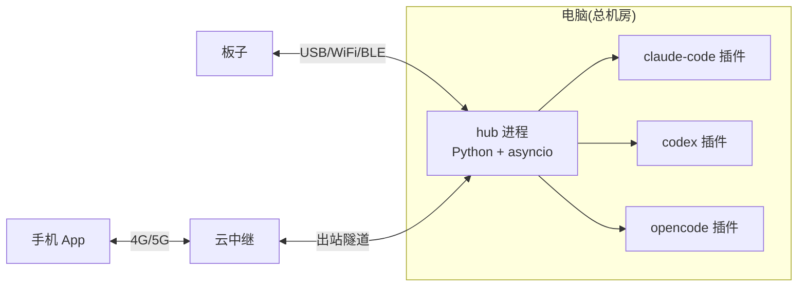

# BOSS PHONE 部署与运维指南

| 项目 | 内容 |
|---|---|
| 状态 | Draft v0.1 |
| 上游 | [BOSS_PHONE_PRD.md](BOSS_PHONE_PRD.md) · [DESIGN_HUB](BOSS_PHONE_DESIGN_HUB.md) · [DESIGN_PLUGIN](BOSS_PHONE_DESIGN_PLUGIN.md) |
| 日期 | 2026-08-24 |

本文覆盖从"拿到硬件"到"稳定运行"的全过程：PC 端部署、插件安装、设备配对配网、升级、运维与故障排查。

---

## 1. 部署拓扑与所需软件



| 端 | 需要部署 | 可选 |
|---|---|---|
| PC | Python 3.11+ 运行时 + hub 包（`pip install`）；`boss-plugin` 安装器；Claude Code/Codex/OpenCode 本体 | 云中继客户端（阶段 3） |
| 板子 | 烧录 Boss Phone 固件（M1 起）；首次 USB 配网 | — |
| 手机 | Boss Phone App；厂商推送通道授权 | — |
| 云端 | 云中继服务（自建 frp/WS 或第三方） | 阶段 3 |

---

## 2. Hub 部署（PC 端）

### 2.1 安装

```bash
# 1) 安装 Python 3.11+（Windows 安装器勾选 "Add to PATH"）
# 2) 创建虚拟环境并安装依赖
python -m venv .venv
.venv\Scripts\activate            # Windows；Linux/macOS: source .venv/bin/activate
pip install -r hub/requirements.txt
# 3) 安装 hub 包（可编辑模式，源码更新即生效）
pip install -e hub/
```

### 2.2 配置 `hub.toml`

```toml
[serial]
port = "COM5"            # 板子 CDC1 串口；留空则纯 WS 模式
baud  = 115200           # CDC 虚拟串口波特率（可任意，常为 115200）

[ws]
listen = "0.0.0.0:8765"  # 局域网 WebSocket 入口
token  = "change-me"     # 设备/插件连接鉴权（DESIGN_SECURITY）

[relay]                  # 阶段 3
enabled = false
server  = "wss://relay.example.com"
token   = "..."

[operator]
provider = "openai"      # 或 deepseek/qwen...
model    = "gpt-4o-audio-preview"  # 多模态直听；两段式则填 STT+LLM 两模型
api_key  = "..."

[telemetry]
interval_sec = 30
github_token = ""        # CI 查询用（可选，留空走 gh CLI）
budget_month = 500       # token 预算告警(元)
```

### 2.3 运行与自启

| 平台 | 方式 |
|---|---|
| Windows | 计划任务开机自启；或 NSSM 服务化 |
| Linux/macOS | systemd unit（示例见下）/ launchd |

```ini
# /etc/systemd/system/boss-hub.service
[Unit]
Description=Boss Phone Hub
After=network.target
[Service]
ExecStart=/opt/boss/.venv/bin/python -m hub serve --config /opt/boss/hub.toml
Restart=on-failure
[Install]
WantedBy=multi-user.target
```

### 2.4 无板调试模式

`python -m hub serve --virtual-cdc`：虚拟一个串口设备，配合模拟板子脚本（`python -m hub sim`）可脱离硬件开发调试。

---

## 3. 插件安装（PC 端）

```bash
boss-plugin install claude-code --repo C:\repos\repo-a --hub ws://127.0.0.1:8765
boss-plugin install codex        --repo C:\repos\repo-b --hub ws://127.0.0.1:8765
boss-plugin install opencode     --repo C:\repos\repo-c --hub ws://127.0.0.1:8765
boss-plugin list                 # 查看已注册 Agent
boss-plugin uninstall repo-b     # 卸载
```

- 安装器自动写入各 CLI 配置（Claude Code `.claude/settings.json` hooks、Codex `config.toml` notify、OpenCode 插件目录）。
- 验证：`boss-plugin status repo-a` 应显示 `connected`，且 Hub `hub link` 能看到该 Agent。
- 故障：hook 路径写错 → 以 `boss-plugin doctor` 诊断。

---

## 4. 设备配对与配网

### 4.1 板子首次接线

1. Type-C 连接 PC，板子进入 DESK_USB：CDC0=调试台（日志），CDC1=协议传输。
2. `hub serve` 检测到 CDC1 → 自动 hello 握手。
3. 无 USB 时：预配置的 WiFi 连接（设置→链路→配网），或经 BLE 由手机 App 配网（阶段 3）。

### 4.2 配对码（首次连接）

- USB 首连：板子屏幕显示 6 位配对码，Hub 端 `hub pair <code>` 确认，绑定后写入 nvs。
- BLE 配对：App 与板子走系统级 `BOND_BONDING`，绑定一次后续自动回连。
- 云中继首次注册：PC 生成一次性配对 token，App/板子扫码/输入后绑定。

### 4.3 WiFi 配网（阶段 2）

| 方式 | 说明 |
|---|---|
| USB 配网 | 设置页填 SSID/密码，经 CDC1 下发并保存 nvs |
| BLE 配网 | App 扫描到板子广播 → 下发 WiFi 凭据（阶段 3） |

---

## 5. App 部署（手机）

1. 安装 APK（侧载或应用市场）。
2. 首次启动 → 授权：通知权限、定位（BLE 扫描所需，Android 12+ 附近设备权限）、后台运行白名单。
3. 厂商推送：小米/华为/OPPO/vivo 按引导开启"自启动/后台运行/通知"，否则离网唤醒不可达（DESIGN_ANDROID §4）。
4. 云中继配对：输入 PC 生成的配对 token。
5. 验证：局域网内打开 App → 电话簿应显示与板子一致的 Agent 列表。

---

## 6. 升级流程

| 对象 | 链路 | 说明 |
|---|---|---|
| 板子固件 | USB 优先 / WiFi OTA / 中继暂存 OTA | OTA A/B 双分区（DESIGN_FIRMWARE §2）；升级后自动回滚校验失败 |
| Hub | 更新代码 + 重启（systemd 平滑） | 协议只增不改，老固件不失效 |
| 插件 | 更新 boss-plugin 包 + `install --upgrade` | 与 Hub 版本兼容校验 |
| App | 应用商店/侧载 | 与 Hub 协议协商降级 |

**升级铁律**：先升级 Hub → 再插件 → 最后固件/App；任何一端失败不阻塞其他端（hello 协商降级）。

---

## 7. 运维

- **健康检查**：`hub telemetry`（CPU/内存/会话）；`hub link`（各设备链路+seq）。
- **日志**：Hub 标准输出结构化日志；板子 CDC0 调试台；App logcat 过滤 `BossPhone`。
- **备份**：`hub backup` 导出 offline queue 与 Agent 注册表（JSON）。
- **告警阈值**：token 预算 80%/100% 两级告警（设置→总览面板 2 可看）。

---

## 8. 故障排查速查表

| 现象 | 可能原因 | 处理 |
|---|---|---|
| 插线后板子不进 USB 模式 | TinyUSB 未识别/端口占用 | CDC1 端口是否被串口监视器占用；`hub doctor serial` |
| 板子 WS 连不上 | token 不匹配 / 端口错误 | 核对 `hub.toml` token 与设备 nvs；`hub link` |
| Agent 黄灯一直不消 | 插件挂起超时/掉线 | `boss-plugin status`；超时默认 120s 自动 deny |
| CI 不刷新 | GitHub API 限流 | 等缓存(5min)；`telemetry.github_token` 配置 |
| App 收不到离网推送 | 厂商后台限制 / FCM 不可用 | 检查白名单；换厂商通道 |
| BLE 连不上板子 | 配对被清 / 距离 | 重新 BOND；查 App 日志 |
| 内存不足（板子重启） | LVGL 缓冲过大 | 查空闲堆基线；回退缓冲配置 |

---

## 9. 待定项

| # | 事项 |
|---|---|
| D1 | Windows 服务化与更新器（自动下载新版本） |
| D2 | 多 PC 迁移（导出/导入整机配置） |
| D3 | 云中继高可用（阶段 3 设计） |


