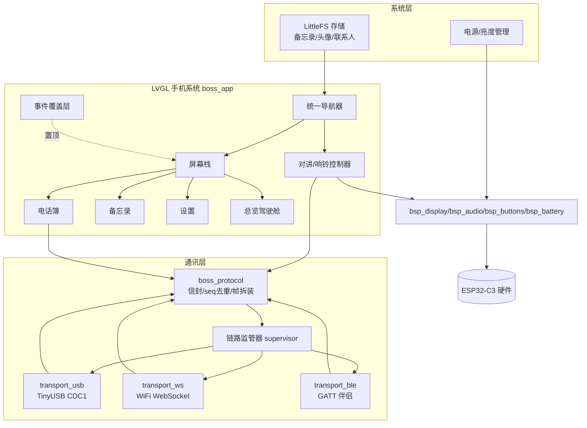
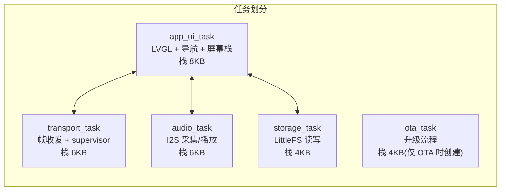
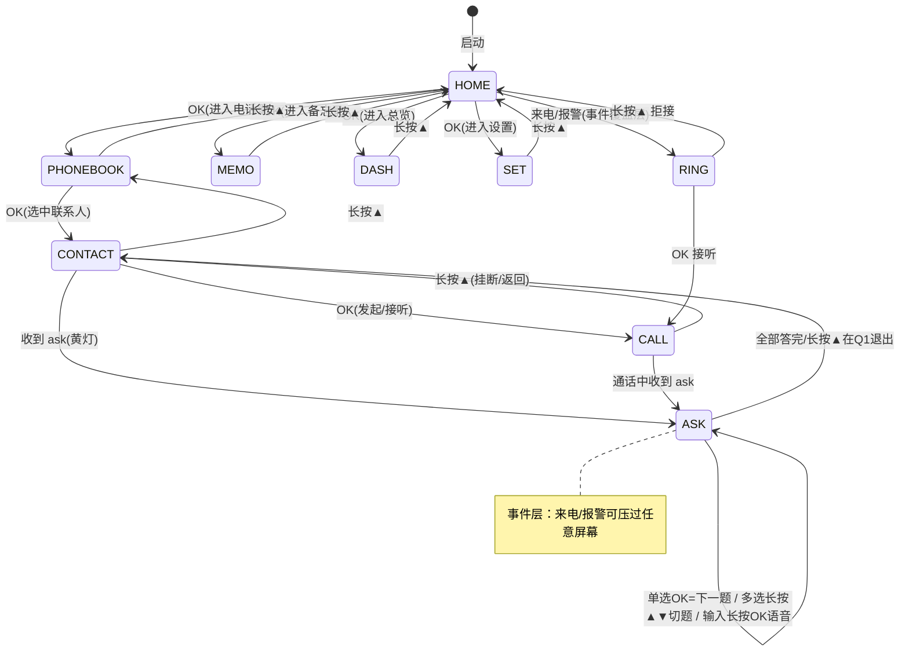
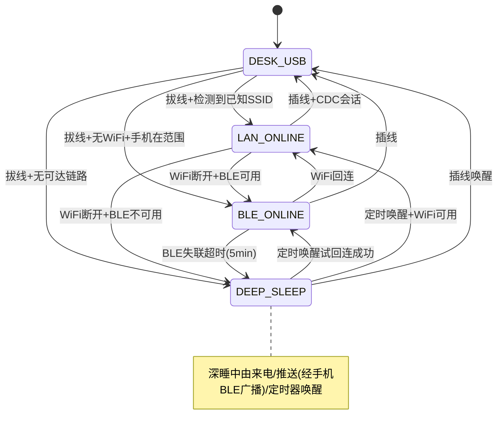
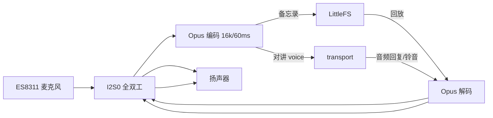

# BOSS PHONE 板端固件设计

| 项目 | 内容 |
|---|---|
| 状态 | Draft v0.1 |
| 上游 | [BOSS_PHONE_PRD.md](BOSS_PHONE_PRD.md) §5.1/§5.2/§5.3/§8 · [DESIGN_OVERVIEW](BOSS_PHONE_DESIGN_OVERVIEW.md) §7.1 |
| 硬件 | ESP32-C3：RISC-V 160MHz / 400KB SRAM / 8MB Flash / 无 PSRAM / WiFi+BLE / ES8311 / ST7789P3 |
| 日期 | 2026-08-24 |

本文定义固件侧三个新组件（`boss_transport` / `boss_protocol` / `boss_app`）的模块设计、Flash 分区、任务模型与内存预算。**现有 `firmware/components/bsp` 与 `reference/folotoy-card-demo/` demo 体系零改动。**

---

## 1. 组件拓扑



## 2. Flash 分区表（8MB）

```svg
<svg viewBox="0 0 760 220" xmlns="http://www.w3.org/2000/svg" font-family="ui-sans-serif,system-ui,Microsoft YaHei,sans-serif" font-size="12">
  <rect x="10" y="10" width="740" height="180" rx="10" fill="#f4f4fa" stroke="#c9c9df"/>
  <text x="20" y="30" font-size="13" font-weight="700" fill="#1b1b2f">ESP32-C3 8MB Flash 分区规划</text>
  <!-- nvs -->
  <rect x="30" y="55" width="90" height="50" rx="6" fill="#e7e0fb" stroke="#7c5cfc"/>
  <text x="75" y="78" text-anchor="middle" fill="#3a2a7a" font-weight="700">nvs</text>
  <text x="75" y="94" text-anchor="middle" fill="#5b5b78">24KB 键值</text>
  <!-- phy_init -->
  <rect x="126" y="55" width="60" height="50" rx="6" fill="#e7e0fb" stroke="#7c5cfc"/>
  <text x="156" y="78" text-anchor="middle" fill="#3a2a7a" font-weight="700">phy_init</text>
  <text x="156" y="94" text-anchor="middle" fill="#5b5b78">4KB</text>
  <!-- factory/app0 -->
  <rect x="192" y="55" width="196" height="50" rx="6" fill="#cdeedd" stroke="#1f9d63"/>
  <text x="290" y="78" text-anchor="middle" fill="#0f6b43" font-weight="700">app0 (factory) 2MB</text>
  <text x="290" y="94" text-anchor="middle" fill="#5b5b78">OTA A：当前固件</text>
  <!-- app1 -->
  <rect x="394" y="55" width="196" height="50" rx="6" fill="#d9e9f7" stroke="#3b82c4"/>
  <text x="492" y="78" text-anchor="middle" fill="#1c4d79" font-weight="700">app1 (ota) 2MB</text>
  <text x="492" y="94" text-anchor="middle" fill="#5b5b78">OTA B：升级暂存</text>
  <!-- ota_data -->
  <rect x="596" y="55" width="52" height="50" rx="6" fill="#e7e0fb" stroke="#7c5cfc"/>
  <text x="622" y="78" text-anchor="middle" fill="#3a2a7a" font-weight="700">ota</text>
  <text x="622" y="94" text-anchor="middle" fill="#5b5b78">8KB</text>
  <!-- storage -->
  <rect x="30" y="125" width="618" height="45" rx="6" fill="#f6e7c8" stroke="#e39b2f"/>
  <text x="339" y="146" text-anchor="middle" fill="#8a5a0a" font-weight="700">storage (LittleFS) 3.9MB</text>
  <text x="339" y="162" text-anchor="middle" fill="#5b5b78">备忘录音频+转写 | 联系人头像 | 字体(可选) | 固件升级包暂存(中继)</text>
  <text x="20" y="200" fill="#8a8aa8">注：app0/app1 各 2MB 满足 OTA 双分区；storage 保留充足空间给录音备忘（1 分钟 Opus≈120KB，3.9MB≈30 分钟）</text>
</svg>
```

| 分区 | 类型 | 大小 | 用途 |
|---|---|---|---|
| nvs | data | 24KB | WiFi/蓝牙配对、设置、seq 持久化 |
| phy_init | data | 4KB | 射频校准 |
| app0 (factory) | app | 2MB | 出厂固件（OTA A） |
| app1 (ota) | app | 2MB | 升级目标（OTA B） |
| ota_data | data | 8KB | OTA 状态 |
| storage | data(LittleFS) | 3.9MB | 备忘录/头像/字体/升级暂存 |

> 与现有仓库 `firmware/sdkconfig.defaults`（8MB 无 PSRAM）对齐；新固件以 `factory` 槽烧录。

## 3. 任务模型与内存预算（400KB SRAM）



| 分配项 | 预算 | 说明 |
|---|---|---|
| LVGL 显示缓冲 | ~46KB | 复用现有单 DMA 缓冲方案，不加大 |
| LVGL 对象/动态 | ~60KB | 默认配置 + 精简对象池 |
| 音频 DMA/PCM 缓冲 | ~24KB | `bsp_audio` 已有 |
| Opus 编码缓冲 | ~12KB | 16k 单声道 60ms 帧 |
| transport 帧缓冲 | ~8KB | RX/TX 各 4KB 环形 |
| 任务栈合计 | ~28KB | 上述 5 任务 |
| WiFi/BLE 协议栈堆 | ~40KB | 由 esp_wifi/esp_ble 内部 |
| cJSON/协议解析暂存 | ~16KB | 信封解析峰值 |
| 系统/驱动余量 | ~剩余 | 保持 ≥15% 空闲堆余量 |

**内存纪律（PRD 8.2）**：
- USB 模式关 WiFi/BLE 射频（省电 + 省堆），仅保留 CDC。
- BLE 模式不建 WiFi，二者不同时开（互斥状态机保证）。
- 备忘录录音仅在 storage_task 空闲时写盘，避免 I2S 中断抖动。
- 新增任何缓冲必须过"400KB 实测基线"检查（AGENTS.md 约束）。

## 4. 统一导航状态机（boss_app）

三键语义见 PRD §6.1。核心是"长按 ▲ = 全局后退"。



## 5. 链路监管器状态机（boss_transport）



- **切换动作**：切换前 `protocol` 发 `sync(since_seq)`，保证消息不丢。
- **会话在位判定**：USB 模式以 CDC 会话活跃（非仅插线）为准；WiFi 以 WS 心跳为准。
- 切换瞬间双链路并存 → 板端按 `(from,seq)` 去重。

## 6. transport 接口（骨架）

```c
/* components/boss_transport/include/boss_transport.h */
typedef enum { BOSS_LINK_USB, BOSS_LINK_WS, BOSS_LINK_BLE } boss_link_t;

typedef struct {
    boss_link_t link;
    esp_err_t (*connect)(void);                  /* 阻塞直到会话建立 */
    bool      (*up)(void);                       /* 心跳健康 */
    int       (*send_frame)(const uint8_t *f, size_t n);
    int       (*recv_frame)(uint8_t *buf, size_t n, int timeout_ms);
    void      (*disconnect)(void);
} boss_transport_ops_t;

void boss_transport_supervisor_start(void);
void boss_transport_on_frame(boss_frame_cb_t cb); /* → boss_protocol */
```

## 7. boss_protocol 骨架

```c
/* components/boss_protocol/include/boss_protocol.h */
typedef void (*boss_msg_cb_t)(const cJSON *envelope);

void boss_protocol_init(boss_msg_cb_t cb);
int  boss_protocol_send(const char *type, const char *to, cJSON *payload);
/* 内部：seq 自增、帧组装、按 (from,seq) 去重表(最近 256 条 LRU) */
void boss_protocol_handle_sync(const cJSON *sync_data); /* 补收入库 */
```

## 8. 音频管线



- 对讲：长按 OK 采集 → Opus 帧发 `voice`；松开 `final:true`。
- 备忘录：与对讲同管线，但落盘 LittleFS（`kind:memo` 文件）。
- 响铃：本地预存铃声（或 Hub 下发 `file:ota/ringtone`）→ Opus 解码播放。
- 音量：`bsp_audio_set_volume` 直控；设置页联动。

## 9. 屏幕与显示

- 屏幕栈：每应用一个 LVGL screen，压栈/弹栈由导航器管理。
- 事件覆盖层：`ring`/`red_alert` 时在栈顶压全屏弹窗（不销毁下层）。
- 240×320 内容约束：联系人行 = 头像(48) + 名称(省略号) + 状态灯(16)；正文摘要 ≤4 行，长文由 Hub 预截断。
- 亮度/息屏：`bsp_display_backlight(0..100)`；策略由电源管理实现（PRD 8.1）。

## 10. M1 固件交付清单

| # | 交付 | 验收 |
|---|---|---|
| 1 | 分区表落地 + LittleFS 初始化 | `idf.py build` 通过，`storage` 可读写 |
| 2 | boss_protocol（信封/seq/帧） | 与 Hub 跑通 hello/sync |
| 3 | boss_transport + usb 实现（TinyUSB 双 CDC） | 插线握手成功，CDC0 日志 + CDC1 协议并存 |
| 4 | boss_app 框架（导航/屏幕栈/事件层） | 模拟数据全 UI 流程可走通 |
| 5 | 电话簿/问答/来电/备忘录录音回放 | 演示脚本逐条过 |
| 6 | 内存基线报告 | 空闲堆 ≥15%，写入 PR |

## 11. 风险

| # | 风险 | 应对 |
|---|---|---|
| F1 | TinyUSB 与 USB-Serial/JTAG 模式互斥（同一 USB 控制器） | 双 CDC（CDC0 调试台+CDC1 协议）；开发期可切回 JTAG；烧录走 ROM 下载模式验证 |
| F2 | Opus 在 C3 的编码耗时/内存 | 实测 60ms 帧实时率；不足则降码率或换 codec2 |
| F3 | LittleFS 与 OTA 并发写 | 录音/写盘走 storage_task 串行；OTA 前校验空闲空间 |
| F4 | 深睡唤醒源限制 | 优先用 BLE 广播做唤醒（手机触发），RTC 定时兜底 |
