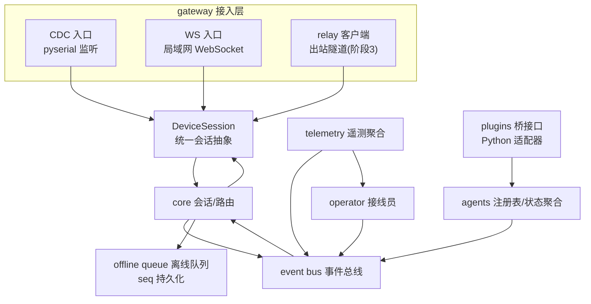
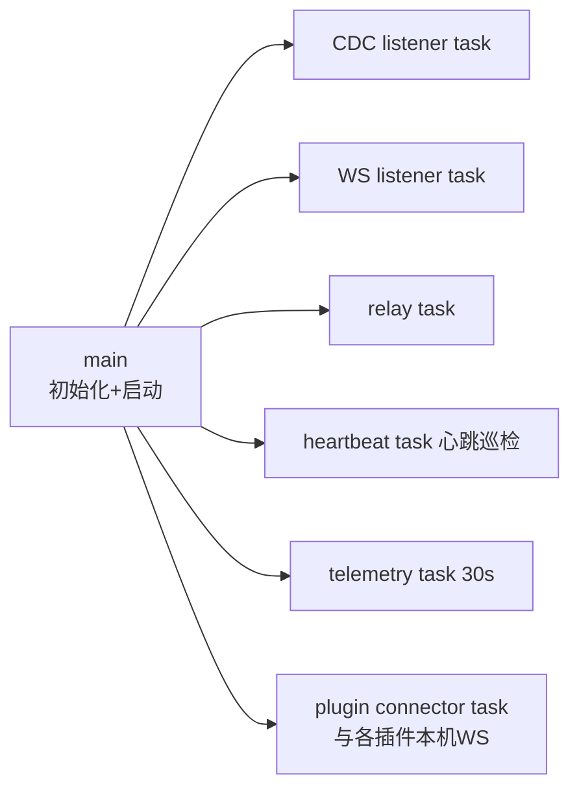
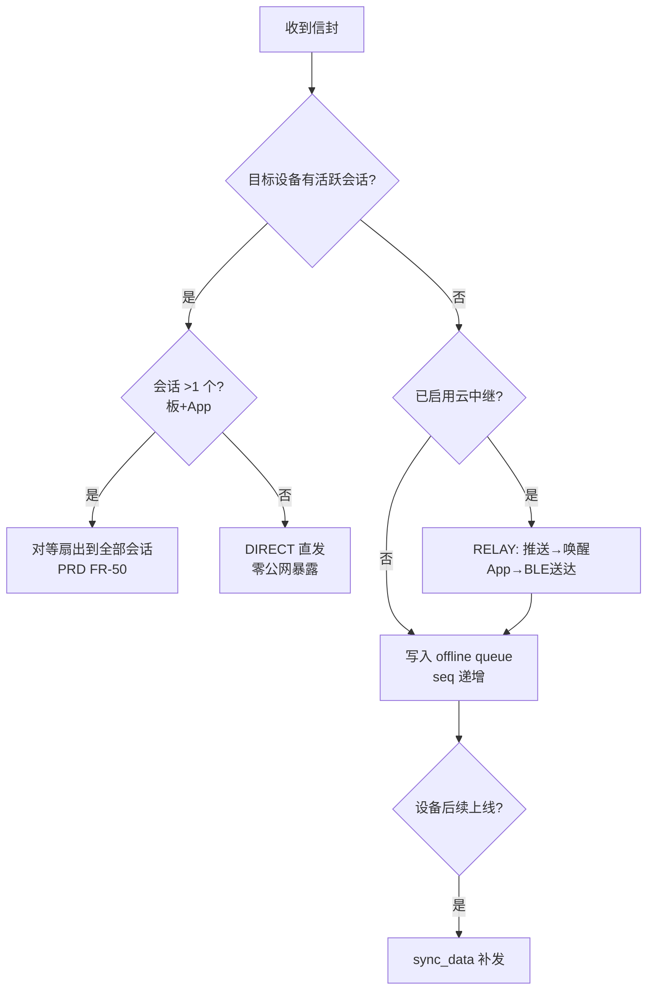
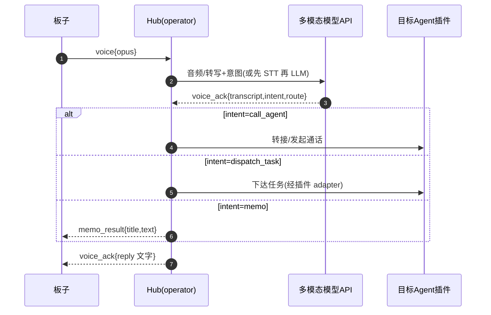

# BOSS PHONE PC 总机房设计（Hub）

| 项目 | 内容 |
|---|---|
| 状态 | Draft v0.2 |
| 上游 | [BOSS_PHONE_PRD.md](BOSS_PHONE_PRD.md) §3/§4/§5.6 · [DESIGN_OVERVIEW](BOSS_PHONE_DESIGN_OVERVIEW.md) §7.2 |
| 技术栈 | Python 3.11+ / asyncio；常驻单进程；出站连接为主（可穿 CGNAT，无需公网 IP） |
| 日期 | 2026-08-30（v0.1 曾为 Rust+tokio，按计划书定为 Python） |

Hub 是整系统的中枢：接收多端连接（USB CDC / WebSocket / 云中继隧道）、维护设备会话、做链路路由决策、转发 Agent 事件、聚合遥测、调度接线员。

---

## 1. 模块架构



### 模块职责

| 模块 | 职责 |
|---|---|
| gateway | 三入口监听（`pyserial` / `websockets` / `aiohttp` 隧道），各自解析帧 → 生成同一 `DeviceSession` |
| core/router | 心跳判定 + DIRECT/RELAY 路由决策（PRD §4.2） |
| event bus | 全内部分发（asyncio 事件总线）；消息顺序保证（按 from seq） |
| offline queue | 每设备 seq 递增，断线事件落盘（`queue/<device>.jsonl`），重连补发 |
| agents | 插件注册的 Agent 表：presence/state/ask 聚合，来电调度 |
| operator | 接线员：STT（faster-whisper / windows-SAPI / 云 API）+ 词表纠错 + LLM 意图路由 + 备忘转写/派发 |
| telemetry | PC 资源采集（`psutil` 30s）、token 聚合、commit/CI 查询（GitHub API） |

## 2. 进程模型（asyncio）



- 每接入一个会话 spawn 一个 session task；媒体（voice/audio）流量不进 event bus，走直连通道（避免序列化瓶颈）。
- 状态/遥测等低频消息经 event bus（asyncio 事件分发 + 每订阅者序号）。
- 说明：asyncio 单事件循环承载全部任务，CPU 密集工作（whisper 推理）放 `asyncio.to_thread` / 进程池，避免阻塞事件循环。

## 3. 路由决策（core/router）



路由决策表：

| 设备会话状态 | 行为 |
|---|---|
| USB CDC 会话活跃 | 最高优先级：一切走 USB（同时停无线推送） |
| WS 心跳正常（局域网） | DIRECT 直发；**不发公网推送（手机零负担）** |
| 全部失活 + 中继开启 | RELAY：消息→云中继→厂商推送→唤醒 App→BLE |
| 全部失活 + 中继关闭 | 写 offline queue，等设备回连 |

**心跳**：设备 10s 一个 ping（WS/CDC 各层）；Hub 30s 巡检，连续 2 次超时判失联。

## 4. 离线队列与 seq

- 每设备一个单调递增 `seq` 池（Hub 侧分配，持久化）。
- 断线事件追加写 `queue/<device>.jsonl`（含 seq）。
- 设备重连 hello 带 `resume_seq` → Hub 从 `resume_seq+1` 开始 `sync_data` 分页补发（每批 ≤64 条）。
- 板端确认 `sync{since_seq}` 后，Hub 可归档已确认段（保留 7 天轮转）。

## 5. 接线员（operator）



- 接线员本身是 Hub 内的一个任务，通过**可替换 provider 接口**接入模型（Q1 决策点）：
  - 多模态直听（audio→意图）
  - 两段式（STT→LLM）
- 备忘录转写与接线员共用 provider 以降成本（Q5 倾向）。
- **语音输入法（第一优先级，§OVERVIEW 8.6）**：STT 之后不是"展示文本"，而是经**词表纠错层**（`operator/correct`，无 LLM 依赖、JSON 热更新）修正专有名词后，由 `input/inject` **打到当前前台光标处**（Windows SendInput + 剪贴板兜底）。编排在 `dictation.py`；板子长按 OK 是触发端（M1 接 gateway）。

## 6. 遥测聚合（telemetry）

| 数据 | 采集方式 | 推送 |
|---|---|---|
| PC CPU/内存 | `psutil` 30s | `telemetry` 周期；BLE 端自动降频 2min |
| 活跃会话数 | agents 注册表计数 | 同上 |
| Token 用量 | 各插件 usage 上报 → 聚合按日/月 | `usage` 变更即推 |
| commit | 插件上报 + 轮询 git | `commit` 事件 |
| CI 状态 | `gh` CLI / GitHub API 查询（每 commit 一次） | `ci` 事件；fail→red_alert |

- Token 统计精度：依插件 `usage-exact / usage-approx / none` 分级，面板标注可信度（R9 风险）。
- CI 失败联动：`ci=fail` 或 `state=blocked` → 触发 `ring(red_alert)` + 状态灯红。

## 7. 插件桥接口（plugins）

```python
# plugins/core 提供的统一接入接口（Hub 侧视角，Python ABC）
from abc import ABC, abstractmethod

class AgentHandle(ABC):
    agent_id: str
    cli: str            # claude-code / codex / opencode / trae
    caps: list[str]     # AdapterCaps

    @abstractmethod
    async def send_ask(self, ask: dict) -> list[dict]: ...   # 权限问题组 → 回答列表
    @abstractmethod
    async def send_task(self, task: str) -> None: ...
    @abstractmethod
    async def notify(self, note: dict) -> None: ...
    @abstractmethod
    async def kill(self) -> None: ...                        # 重启会话(FR-49)
```

Hub 侧不感知 CLI 差异；差异全在插件适配器（见 DESIGN_PLUGIN）。

## 8. 配置与运行

- 配置文件 `hub.toml`：串口名/波特率、WS 端口、中继地址、模型 provider、STT 引擎选择、预算告警阈值、语音输入法（`dictation`：注入方式/阈值/纠错开关/用户词表/热词）。
- 命令（`hub/` 包，`python -m hub`）：
  - `python -m hub serve`（默认）
  - `python -m hub link <device>` 显示设备会话/seq/链路
  - `python -m hub telemetry` 打印遥测
  - `python hub/hub-lite.py <wav> --engine ... --type` 语音输入法入口（STT→纠错→注入光标处；`--selftest` 只验注入能力，见 DESIGN_OVERVIEW §8.6）
- 依赖：`pyserial`、`websockets`、`aiohttp`、`pydantic`、`psutil`；STT 按引擎选装 `faster-whisper` / `openai`。
- 常驻内存目标 ~60-80MB（§DESIGN_OVERVIEW 4.1）。

## 9. M1 Hub 交付清单

| # | 交付 | 验收 |
|---|---|---|
| 1 | CDC 入口（pyserial）+ DeviceSession | 板子插线 hello 握手成功 |
| 2 | core/router + event bus | 板↔Hub 状态流转通 |
| 3 | offline queue + sync | 断开/重连补发验证 |
| 4 | plugin connector（接 claude-code 适配器） | 真实状态上电话簿 |
| 5 | operator 骨架（provider 接口） | mock provider 回显 |
| 6 | 语音输入法：gateway 接 `voice.start`（长按 OK 触发）→ STT → 纠错 → 光标注入 | 板子长按 OK 说话，文字落到 PC 光标处 |

## 10. 风险

| # | 风险 | 应对 |
|---|---|---|
| H1 | 串口被占用（VS Code 串口监视器） | 检测占用并提示；提供虚拟 CDC 模拟模式供无板调试 |
| H2 | asyncio 任务数随设备增长 | 上限控制；媒体直连通道独立，不占 event bus |
| H3 | GitHub API 限流 | CI 查询缓存（5min）+ 请求合并 |
| H4 | 多模态模型延迟 | 语音段并发转写（to_thread/进程池）；UI 上"接线员处理中"状态 |
