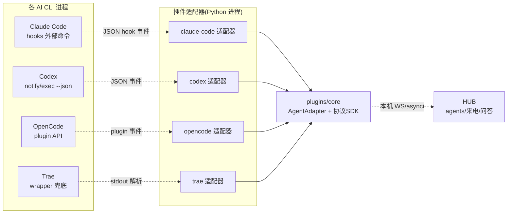
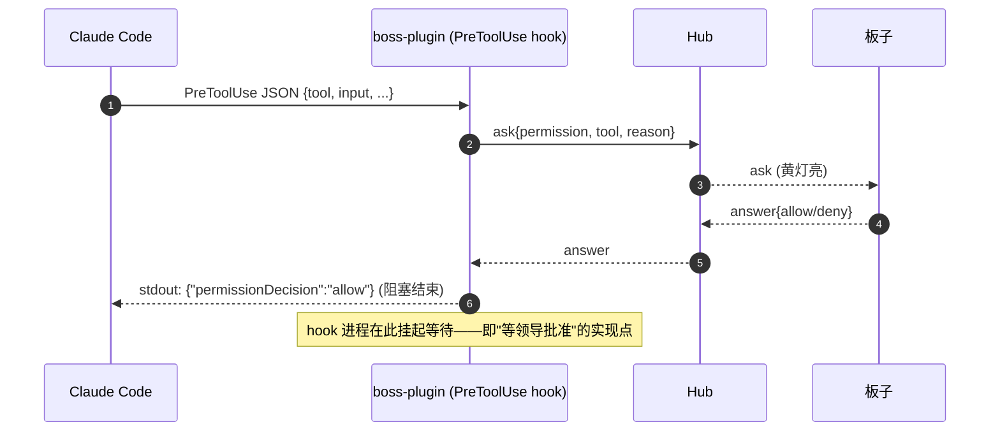

# BOSS PHONE CLI 插件桥设计

| 项目 | 内容 |
|---|---|
| 状态 | Draft v0.2 |
| 上游 | [BOSS_PHONE_PRD.md](BOSS_PHONE_PRD.md) §5.5 · [DESIGN_OVERVIEW](BOSS_PHONE_DESIGN_OVERVIEW.md) §5 |
| 技术栈 | Python 3.11+（plugins/core 共享包；各 CLI 一个适配器进程） |
| 日期 | 2026-08-30（v0.1 曾为 Rust，按计划书定为 Python，与 Hub 同语言） |

插件桥让各 AI CLI（Claude Code / Codex / OpenCode / Trae）接入 Boss Phone：上报状态、挂起等权限、主动提问、上报 usage/commit。**统一协议，能力降级**是核心策略。

---

## 1. 总体形态



## 2. 统一适配接口（plugins/core）

```python
# plugins/core/adapter.py —— 设计骨架（Python ABC，与 Hub 同语言共享协议绑定）
from abc import ABC, abstractmethod
from enum import Enum


class CliKind(str, Enum):
    ClaudeCode = "claude-code"
    Codex = "codex"
    OpenCode = "opencode"
    Trae = "trae"


class UsagePrecision(str, Enum):
    exact = "exact"
    approx = "approx"
    none = "none"


class AdapterCaps:
    def __init__(self, *, status_report=False, permission_suspend=False,
                 proactive_ask=False, usage=UsagePrecision.none, commit_hook=False):
        self.status_report = status_report      # 状态上报 → 红黄绿灯
        self.permission_suspend = permission_suspend  # 能否挂起等用户回答（黄灯核心）
        self.proactive_ask = proactive_ask      # 主动提问
        self.usage = usage                      # exact / approx / none
        self.commit_hook = commit_hook          # 能否捕获 commit 事件


class AgentAdapter(ABC):
    agent_id: str           # 仓库名
    cli: CliKind
    caps: AdapterCaps       # 能力声明 → Hub 降级依据

    @abstractmethod
    async def start(self, hub_ws) -> None: ...          # 连上 Hub 本机 WS
    @abstractmethod
    async def stop(self) -> None: ...
    @abstractmethod
    async def send_ask(self, ask: dict) -> list[dict]: ...  # 权限问题组 → 回答列表
    @abstractmethod
    async def send_task(self, task: str) -> None: ...
    @abstractmethod
    async def notify(self, note: dict) -> None: ...
    @abstractmethod
    async def kill(self) -> None: ...                   # 重启会话（FR-49）
```

## 3. 能力矩阵与降级

| 能力 | Claude Code | Codex | OpenCode | Trae |
|---|---|---|---|---|
| status_report | ✅ hooks | ✅ notify | ✅ event | ⚠️ wrapper |
| **permission_suspend** | ✅ 强(PreToolUse 挂起) | ⚠️ 弱(notify 只通知) | ✅ 强(permission 事件) | ⚠️ 待调研 |
| proactive_ask | ✅ Notification | ✅ notify | ✅ event | ⚠️ |
| usage | exact | exact(token-count) | exact(消息级) | ⚠️ |
| commit_hook | ✅ | ✅ | ✅ | ⚠️ |

**Hub 降级规则**（依 `AdapterCaps` 执行）：
1. `permission_suspend=false`（Codex）：权限请求降级为**事后通知**——Agent 按自身 policy 执行，Hub 推"repo-B 已自动执行 X（策略 on-failure）"，黄灯退化为"通知灯"，用户可事后叫停（FR 补充）。
2. `usage=none`：Token 面板该 Agent 显示"不支持统计"。
3. `commit_hook=false`：由 Hub 定时 `git log` 兜底采集。

## 4. Claude Code 适配器（M1 打样）

### 4.1 hooks 配置（由安装器写入 `.claude/settings.json`）

```json
{
  "hooks": {
    "SessionStart": [{ "hooks": [{ "type": "command", "command": "boss-plugin claude-code session-start" }] }],
    "PreToolUse":   [{ "hooks": [{ "type": "command", "command": "boss-plugin claude-code pre-tool" }] }],
    "PostToolUse":  [{ "hooks": [{ "type": "command", "command": "boss-plugin claude-code post-tool" }] }],
    "Notification": [{ "hooks": [{ "type": "command", "command": "boss-plugin claude-code notify" }] }],
    "Stop":         [{ "hooks": [{ "type": "command", "command": "boss-plugin claude-code stop" }] }]
  }
}
```

### 4.2 权限挂起流程（"黄灯"核心实现）



- hook 进程在等 answer 期间**阻塞**（Claude Code 因此暂停工具执行），超时（默认 120s，可配）回 `deny` 并 notify 用户。
- 多选/输入题复用 §PROTOCOL 6.2 的 ask/answer 结构。

### 4.3 状态上报

- `SessionStart` → presence online；`Stop` → presence offline。
- `PostToolUse` 解析当前任务 → state `running` + task 摘要。
- `Notification`（agent 主动提示）→ proactive_ask → ring。
- token usage：hook 事件内 usage 字段 → Hub 聚合。

## 5. Codex 适配器

- 配置 `~/.codex/config.toml` 的 `[notify]` 指向 boss-plugin codex 入口（JSON 事件：`agent-turn-complete` / `token-count` / `update-available` 等）。
- `exec --json` 事件流解析任务进度 → state。
- **无挂起**：approval_policy 预设（`on-request` / `on-failure`）；`on-request` 模式依赖 Codex 自身的交互式确认——插件不拦截，仅转发事件到 Hub 做通知。降级规则见 §3-1。
- usage：`token-count` 事件 → exact。

## 6. OpenCode 适配器

- OpenCode 支持本地插件（Node/TS），但我们的桥是 Python——**采用其进程外事件协议**：插件侧用其官方 plugin SDK 写一个极薄桥（把事件转成 stdin/stdout JSON 交给 boss-plugin opencode 进程），避免全栈 TS。
- `permission` 事件可异步等待外部决定（我们由 Hub 回答后经桥回写）。
- 事件：`chat.message` / `tool.execute.start` / `tool.execute.end` / `permission`。

## 7. Trae 适配器（待调研，wrapper 兜底）

- 若 Trae 无开放 hook：外层 wrapper 进程启动 Trae，解析其 TUI 输出/exit code/日志推断状态。
- 能力降级：status_report=approx（解析日志）、permission_suspend=false、usage=none。

## 8. 安装与生命周期

- `boss-plugin install <cli> --repo <path> --hub <ws://127.0.0.1:port>`：写入对应 CLI 配置 + 注册到 Hub。
- `boss-plugin uninstall`：移除配置。
- 常驻：适配器进程与 Hub 本机 WS 长连；Hub 挂则指数退避重连。
- 安全：本机回环 WS + 简单 token 鉴权（DESIGN_OVERVIEW §8.3 对应）。

## 9. M1 交付清单

| # | 交付 | 验收 |
|---|---|---|
| 1 | plugins/core（AgentAdapter + 协议绑定） | `pytest` 通过，协议类型与 Hub 共享（`protocol/python`） |
| 2 | claude-code 适配器（hooks 五事件 + 挂起） | 真机：Claude Code 触发 PreToolUse → 板子批准 → 恢复执行 |
| 3 | codex 适配器（notify 降级） | 状态/usage 上报通，权限走通知灯 |
| 4 | 安装器（install/uninstall） | 一键配置 hooks 并注册 |

## 10. 风险

| # | 风险 | 应对 |
|---|---|---|
| P1 | Claude Code hooks JSON 结构随版本变动 | 版本锁定 + 结构校验 + 快速失败提示升级插件 |
| P2 | Codex "事后通知"体验弱 | UI 措辞：通知灯显示"已自动执行，可叫停"；后续推动 Codex 提供挂起机制 |
| P3 | 每个仓库一个适配器进程的资源开销 | 单进程多适配器实例共享事件循环与协议栈；空闲适配器进入轻量轮询 |
| P4 | Trae 能力不明 | 保持 wrapper 兜底设计；能力实测后回填矩阵 |
