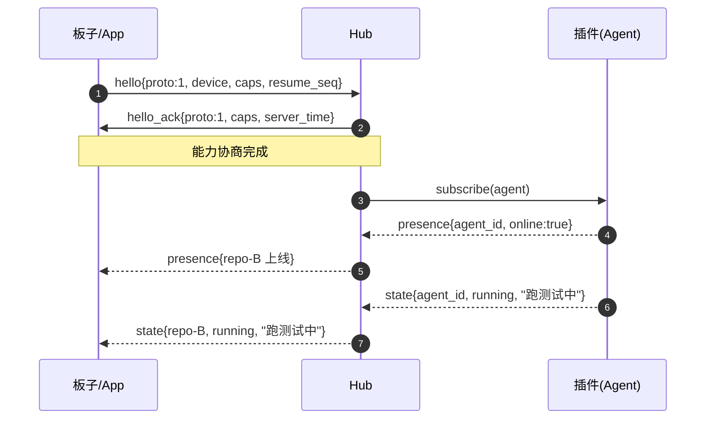
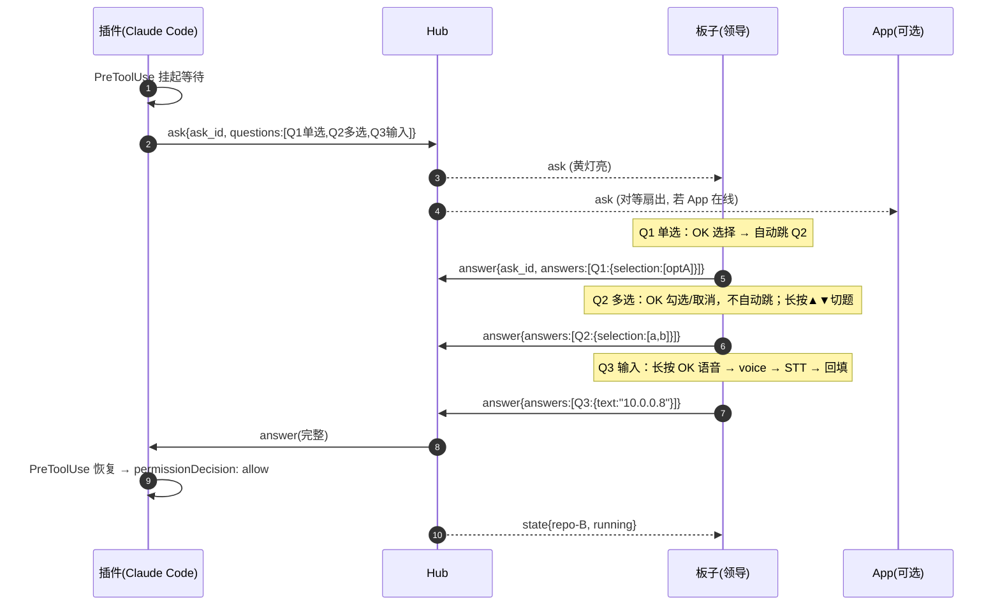
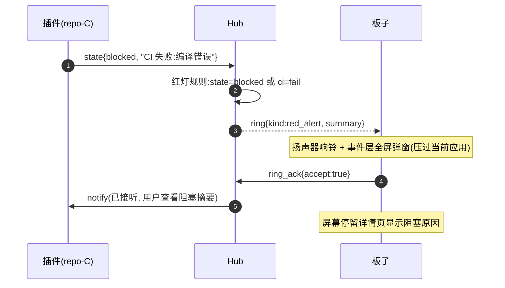
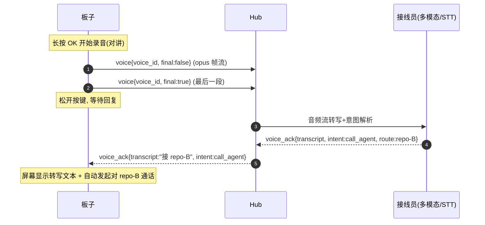
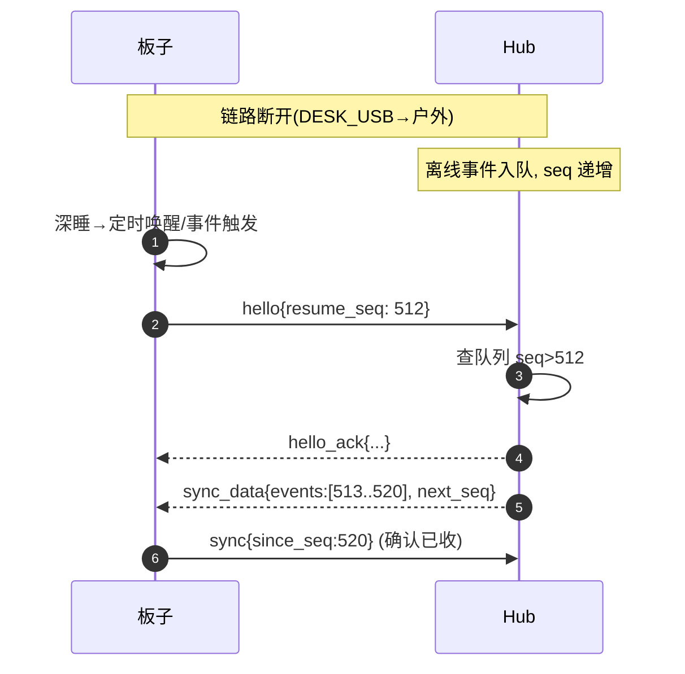
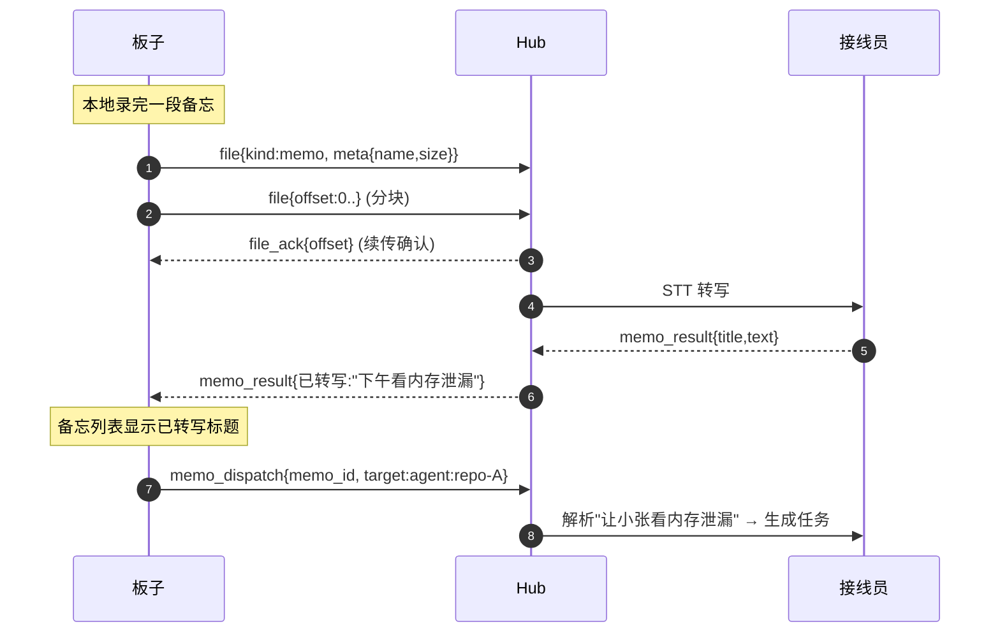
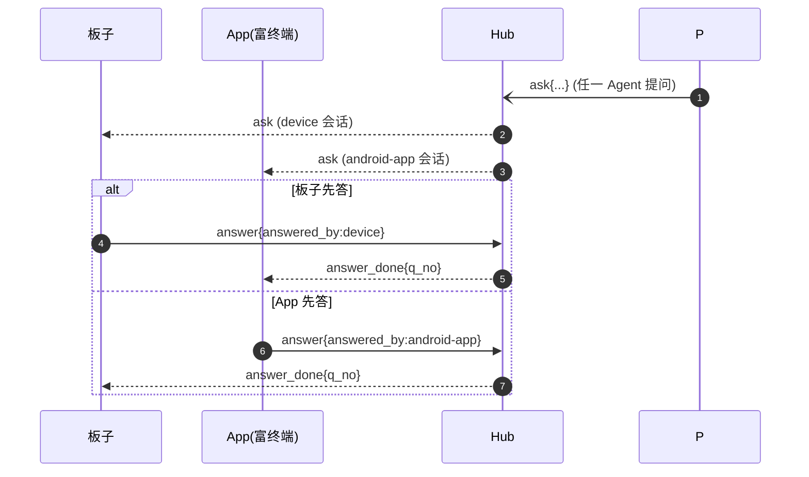

# BOSS PHONE 通讯协议规范

| 项目 | 内容 |
|---|---|
| 状态 | Draft v0.1 |
| 上游 | [BOSS_PHONE_PRD.md](BOSS_PHONE_PRD.md) §7 · [BOSS_PHONE_DESIGN_OVERVIEW.md](BOSS_PHONE_DESIGN_OVERVIEW.md) §6 |
| 日期 | 2026-08-24 |

本文档是**协议的唯一事实来源（SSOT）**。所有端（板子固件 C + Rust 业务层 / PC 总机房 Python / 安卓 App Kotlin）必须依据 `protocol/schema/*.json` 生成代码，禁止手写消息结构。本文描述字段语义与交互时序。

---

## 1. 设计原则

1. **只增不改**：消息类型与字段只增不删不改语义；未知字段一律忽略，未知消息类型一律忽略并回复 `error(type=unsupported)`。
2. **hello 版本协商**：每次连接握手交换 `proto` 整数版本，取 min 共同版本。
3. **caps 能力协商**：双方声明能力字符串集，按对方能力裁剪功能（见 §6）。
4. **统一信封**：所有消息套同一信封，与链路无关；链路差异只在帧封装层（§4）。
5. **可靠语义**：控制消息有 `seq` 与去重；媒体（voice/audio/file chunk）允许少量丢弃，靠上层重试。

---

## 2. 消息信封（Envelope）

```json
{
  "type":  "state",
  "from":  "agent:repo-b",
  "to":    "device",
  "seq":   12345,
  "ts":    1756000000000,
  "payload": {}
}
```

| 字段 | 类型 | 必填 | 说明 |
|---|---|---|---|
| type | string | 是 | 消息类型，见 §3 |
| from | string | 是 | 发送方 ID：`agent:<repo>` / `hub` / `operator` / `device` / `android-app` |
| to | string | 是 | 接收方：`device` / `operator` / `agent:<repo>` / `all`（多端扇出见 §8） |
| seq | uint | 控制消息必填 | 发送方本地递增；对端据此去重与补收（§5） |
| ts | uint64 | 否 | 毫秒时间戳（发送时本地时钟，仅展示） |
| payload | object | 是 | 各类型专属字段 |

> 媒体帧（voice/audio/file 数据段）不套 JSON 信封，走二进制帧（§4.2），其控制信息由配套控制消息携带。

---

## 3. 消息字典

> 字段表只列关键字段；完整 JSON Schema 见 `protocol/schema/*.json`。`▲` 表示数组元素对象。

### 3.1 握手与会话

#### hello（任意端 → Hub）
| 字段 | 类型 | 说明 |
|---|---|---|
| proto | uint | 客户端支持的协议版本（当前 1） |
| device | string | 设备身份：`passport:<mac>` / `android-app:<uuid>` |
| fw | string | 固件/App 版本（如 `0.1.0`） |
| caps | string[] | 能力集（§6） |
| resume_seq | uint | 上次会话最后收到的 seq，用于断线补收 |

#### hello_ack（Hub → 端）
| 字段 | 类型 | 说明 |
|---|---|---|
| proto | uint | 协商后的共同版本 |
| caps | string[] | 服务端能力集 |
| device_id | string | 分配/确认的设备号 |
| server_time | uint64 | 服务端毫秒时间戳（端校准时钟用） |

### 3.2 Agent 生命周期与状态

#### presence（插件 → Hub → 端）
| 字段 | 类型 | 说明 |
|---|---|---|
| agent_id | string | 仓库名（电话簿联系人名） |
| online | bool | 上线/下线 |
| cli | string | `claude-code` / `codex` / `opencode` / `trae` |
| cwd | string | 工作目录 |
| caps | ▲{permission_suspend, usage, ...} | 该 Agent 的能力（Hub 据此降级） |

#### state（插件 → Hub → 端）
| 字段 | 类型 | 说明 |
|---|---|---|
| agent_id | string | — |
| state | enum | `running` / `waiting_input` / `blocked` |
| summary | string | 状态摘要（PC 端生成，板端只显示） |
| task | string | 当前任务简述（可空） |
| since | uint64 | 状态起始时间 |

> 状态灯映射：`running`→绿，`waiting_input`→黄，`blocked`→红。

### 3.3 权限请求与回答（核心交互）

#### ask（插件 → Hub → 端）
| 字段 | 类型 | 说明 |
|---|---|---|
| ask_id | string | 问题组 ID（UUID） |
| agent_id | string | 发起 Agent |
| reason | string | 为什么需要权限/输入（摘要） |
| questions | ▲[] | 问题数组（有序） |

questions▲ 元素：
| 字段 | 类型 | 说明 |
|---|---|---|
| q_no | uint | 题号（从 1 起） |
| kind | enum | `single`（单选）/ `multi`（多选）/ `input`（需用户补全） |
| prompt | string | 题目文本 |
| options | string[] | 选项（input 题可空） |
| optional | bool | 是否可跳过 |
| default | string | 默认值（可选，input 题预填） |

#### answer（端 → Hub → 插件）
| 字段 | 类型 | 说明 |
|---|---|---|
| ask_id | string | — |
| answers | ▲{q_no, kind, selection[], text} | 每个被答题目 |
| answered_by | string | `device` / `android-app`（多端场景先答先得，见 §8） |
| ts | uint64 | 回答时间 |

- 单选：`selection` 单元素；多选：`selection` 数组；input：`text` 为补全内容。

### 3.4 通话与来电

#### ring（Hub → 端）
| 字段 | 类型 | 说明 |
|---|---|---|
| ring_id | string | 通话 ID |
| agent_id | string | 来电方 |
| kind | enum | `agent_call` / `red_alert` / `operator` |
| reason | string | 来电/报警原因摘要 |
| summary | string | 阻塞摘要（red_alert 必填，如"CI 失败：编译错误"） |
| ringtone | string | 铃声标识（可空，用默认） |

#### ring_ack（端 → Hub）
| 字段 | 类型 | 说明 |
|---|---|---|
| ring_id | string | — |
| accept | bool | 接听/拒接 |

#### audio（双向，媒体帧）
| 字段（控制伴消息或帧头） | 说明 |
|---|---|
| call_id | 通话 ID（帧头字段） |
| opus 帧 | 二进制载荷（§4.2） |
| seq | 帧序号（丢帧检测） |

#### hangup（双向）
| 字段 | 说明 |
|---|---|
| call_id | — |
| reason | `local` / `remote` / `error` |

### 3.5 语音对讲（walkie-talkie）

#### voice（端 → operator）
| 字段 | 说明 |
|---|---|
| voice_id | 片段 ID |
| opus | 二进制载荷（媒体帧，§4.2） |
| dur_ms | 片段时长 |
| final | bool：长按 OK 松手前最后一段 |

#### voice_ack（operator → 端）
| 字段 | 说明 |
|---|---|
| voice_id | 对应片段 |
| transcript | 转写文本 |
| intent | 解析意图（`call_agent` / `dispatch_task` / `memo` / `unknown`） |
| reply | 接线员文字回复（板端显示用） |
| route | 若 `call_agent`，含目标 agent_id |

### 3.6 遥测与驾驶舱

#### telemetry（Hub → 端）
| 字段 | 说明 |
|---|---|
| cpu | PC CPU % |
| mem | 内存占用（used/total 字符串或两个 uint） |
| agents_active | 活跃 Agent 会话数 |
| uptime | Hub 运行时长秒 |
| period | 推送周期（端据此决定是否降频） |

#### usage（Hub → 端）
| 字段 | 说明 |
|---|---|
| today | ▲{tokens, cost, per_agent[{agent_id,tokens}]} |
| month | ▲{tokens, cost, budget} |

#### commit（插件 → Hub → 端）
| 字段 | 说明 |
|---|---|
| agent_id | — |
| sha | 短 sha |
| branch | 分支 |
| message | 提交消息（截断到 ≤60 字符） |
| pushed | bool 是否已推送远端 |

#### ci（Hub → 端）
| 字段 | 说明 |
|---|---|
| agent_id | — |
| status | `pass` / `fail` / `running` / `unknown` |
| summary | 失败原因（fail 时） |

> `ci=pass` 不改灯；`ci=fail` 直接驱动仓库红灯（与 `state=blocked` 同效，走 ring(red_alert)）。

### 3.7 备忘录与文件

#### file（双向，媒体帧 + 控制）
| 字段 | 说明 |
|---|---|
| file_id | 传输 ID |
| kind | `memo` / `avatar` / `ota` |
| meta | ▲{name, size, mime}（首帧） |
| offset | 本次分块偏移 |
| total | 总字节 |
| data | 二进制载荷（媒体帧） |

#### file_ack（双向）
| 字段 | 说明 |
|---|---|
| file_id | — |
| offset | 已确认接收到的最大偏移（续传点） |
| status | `ok` / `retry` / `abort` |

#### memo_result（Hub → 端）
| 字段 | 说明 |
|---|---|
| memo_id | 本地备忘 ID |
| title | 转写标题 |
| text | 转写全文 |
| status | `transcribed` / `failed` |

#### memo_dispatch（端 → Hub）
| 字段 | 说明 |
|---|---|
| memo_id | — |
| target | `operator` / `agent:<repo>` |

### 3.8 同步与错误

#### sync（端 → Hub）
| 字段 | 说明 |
|---|---|
| since_seq | 从哪个 seq 开始补收 |

#### sync_data（Hub → 端）
| 字段 | 说明 |
|---|---|
| events | Envelope[]（按 seq 升序） |
| next_seq | 下一可用 seq |

#### error（任意）
| 字段 | 说明 |
|---|---|
| code | 错误码（§5.3） |
| msg | 人类可读说明 |
| ref | 触发错误的消息 seq/type |

---

## 4. 帧封装（链路无关）

同一传输流上两种帧按 magic 区分：控制帧（JSON）与媒体帧（二进制）。

```
JSON 控制帧： {envelope_json}\n            # magic 隐含：以 { 开头
媒体二进制帧： MAGIC(2B)|TYPE(1B)|FLAGS(1B)|LEN(2B)|PAYLOAD(LEN)
              MAGIC = 0xAA 0x55
              TYPE  = 0x01 voice | 0x02 audio | 0x03 file-data | 0x04 file-meta
              FLAGS = bit0 final 段 | bit1 first 段
```

### 4.1 各链路分帧细则

| 链路 | 载体 | 特殊处理 |
|---|---|---|
| USB (CDC1) | 字节流 | 直接写帧；接收按 `\n` 或 magic+len 解析 |
| WiFi (WS) | WebSocket binary/text | 控制帧用 text；媒体帧用 binary |
| BLE | GATT RX/TX 特征值 | MTU 协商 247B → 媒体帧切片，加 `FRAG(2B 分片号)` 前缀 + 分片 ACK（§DESIGN_ANDROID） |
| 云中继 | 出站 WS 隧道 | 与 WiFi 同 |

### 4.2 seq 语义

- 每发送方独立维护 `seq`，从 1 递增（不跨端共享）。
- 控制帧必带 `seq`；媒体帧用 `seq` 做丢帧检测（不补，只丢弃后提示）。
- 断线重连：端在 hello 里带 `resume_seq`，Hub 从 `resume_seq+1` 开始补发 `sync_data`；端按 `(from, seq)` 去重。

### 4.3 错误码

| code | 含义 |
|---|---|
| 4000 | 协议版本不兼容 |
| 4001 | 未知消息类型 |
| 4002 | 必填字段缺失 |
| 4003 | 未握手（先 hello） |
| 4100 | ask 已过期/不存在 |
| 4101 | 目标 Agent 离线 |
| 4200 | 传输分块校验失败 |
| 4300 | 设备忙（媒体通道占用） |

---

## 5. 能力协商（caps 词汇表）

| cap | 含义 | 消费者 |
|---|---|---|
| `proto.v1` | 支持协议 v1 | 所有 |
| `audio.opus16k` | 支持 Opus 16k 单声道 | 板子/App/接线员 |
| `audio.pcm` | 支持裸 PCM（USB/WiFi 链路） | 板子 |
| `input.voice` | 支持长按 OK 语音输入 | 板子 |
| `agent.suspend` | Agent 支持挂起等回答 | 插件（permission_suspend） |
| `agent.usage-exact` / `usage-approx` | token 统计精度 | 插件 |
| `file.memo` / `file.avatar` / `file.ota` | 文件传输类型支持 | 端 |
| `relay` | 支持云中继路由 | 板子/App |
| `push.fcm` / `push.vendor` | 推送通道 | App |
| `ui.peer-term` | 对等富终端 UI | App |

协商规则：`hello` 双向声明 → Hub 合并为每设备 `effective_caps` → 降级逻辑在各端执行（例：板子无 `file.ota` 时 Hub 不推 OTA 帧）。

---

## 6. 核心交互时序

> 以下为 mermaid 时序图；PDF 渲染后为矢量图。

### 6.1 连接握手与状态订阅



### 6.2 权限请求（含多题、单选/多选/输入混合）



> **先答先得**：若 App 先对某题作答，Hub 向板子下发 `answer_done{ask_id, q_no}`，板子该题置为"已处理"并跳过，避免双端重复回答。

### 6.3 主动来电与红灯报警



### 6.4 语音对讲（领导→接线员）



### 6.5 断线补收（sync）



### 6.6 备忘录上传与派发



### 6.7 多端对等扇出（板 + App）



---

## 7. 兼容性保证

1. 新增消息类型：老端收到未知 type → 忽略（原则 1）。
2. 新增字段：老端忽略未知字段。
3. 语义变更：**禁止**——只能新增类型/字段模拟新语义（如需要"同意且不再询问"→ 新增 `ask_ack{remember:true}`，不改 `answer`）。
4. 版本不兼容（`proto` 差距过大）：hello_ack 带 `4000` 错误，端提示升级。

---

## 8. 待定项

| # | 事项 |
|---|---|
| P1 | media 帧的 Opus 包长/采样率是否固定（建议固定 60ms/16k/单声道） |
| P2 | BLE 分帧 ACK 的窗口大小与重传超时（DESIGN_ANDROID 定） |
| P3 | `answer_done` 与 `ring` 的幂等规则在并发场景下的细化 |
| P4 | 云中继握手是否需要额外鉴权（token 由 PC 端配对生成） |
