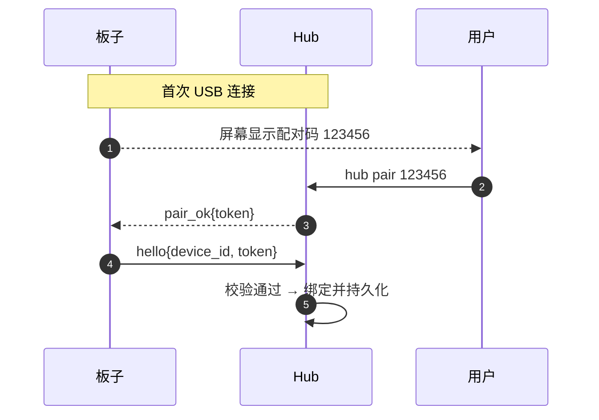
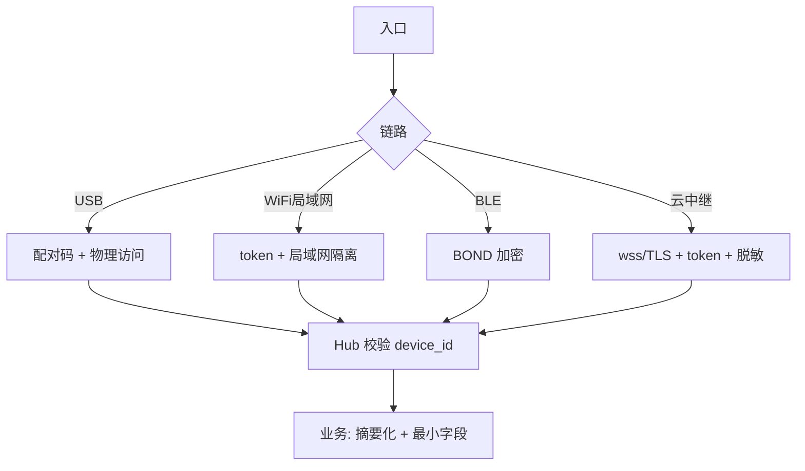

# BOSS PHONE 安全设计

| 项目 | 内容 |
|---|---|
| 状态 | Draft v0.1 |
| 上游 | [BOSS_PHONE_DESIGN_HUB](BOSS_PHONE_DESIGN_HUB.md) · [DESIGN_ANDROID](BOSS_PHONE_DESIGN_ANDROID.md) · [DESIGN_FIRMWARE](BOSS_PHONE_DESIGN_FIRMWARE.md) |
| 日期 | 2026-08-24 |

产品核心安全价值：**局域网/USB 形态零公网暴露**；公网形态只经出站隧道与加密链路。本文给出威胁模型与各层控制。

---

## 1. 威胁模型

| # | 威胁 | 攻击面 | 等级 |
|---|---|---|---|
| T1 | 局域网内他人冒充设备/Hub | WS 接入 | 高 |
| T2 | 工位邻居 USB 插线冒充 | CDC 接入 | 中 |
| T3 | BLE 范围内窃听/伪装 | BLE 链路 | 中 |
| T4 | 云中继被攻破/中间人 | 公网隧道 | 中 |
| T5 | 恶意 CLI 插件上报假状态/诱导批准 | 插件桥 | 高 |
| T6 | 隐私泄露（仓库名/任务/录音） | 所有链路+日志 | 中 |
| T7 | 固件/OTA 被篡改 | OTA 链路 | 中 |

---

## 2. 身份与鉴权

| 层 | 机制 | 说明 |
|---|---|---|
| 设备标识 | `device_id`（hello 携带，USB 绑定写入 nvs） | 唯一身份，不可伪造（nvs 受保护） |
| 设备↔Hub token | `hub.toml` 的 `ws.token`；设备 nvs 保存 | 连接鉴权；首次由配对码建立（见下） |
| 配对码 | USB 首连：板子屏幕 6 位码，`hub pair <code>` | 防 T2：工位邻居插线无法通过 |
| 插件 token | 插件安装器生成，写入 CLI 配置 + Hub | 防 T5 冒名插件 |
| App token | 云中继配对 token（一次性） | 防 T4 越权 |

---

## 3. 链路安全

| 链路 | 安全措施 |
|---|---|
| USB (CDC1) | 本地物理访问 + 配对码（T2） |
| WiFi 局域网 WS | 环回/局域网内 WS + token；**不暴露公网**；可选 TLS（自签） |
| BLE | 系统级 `BOND_BONDING`（配对绑定 + 链路加密）；分帧含校验 |
| 云中继 | 出站 `wss://`（TLS）+ token；服务端不留业务 payload 明文（脱敏） |
| OTA | 镜像签名校验（esp_secure_boot/签名验证）；失败自动回滚 |

**默认安全态**：局域网内 Hub 监听仅绑定局域网接口并校验 token；云中继默认关闭，用户显式开启（阶段 3）。

---

## 4. 隐私与数据最小化

| 数据 | 处理 |
|---|---|
| 仓库名/Agent 名 | 电话簿展示必需；中继转发时信封含，payload 可配脱敏 |
| 任务摘要/状态 | PC 端生成，**只传摘要不传全文**（PRD FR-17） |
| 权限请求内容 | 必要字段最小集（工具名+参数摘要） |
| 录音（备忘/对讲） | 传输走 Opus 压缩；云端不留存；本地上传即删可配 |
| Token 用量 | 聚合统计，不含 prompt/响应内容 |
| 日志 | 默认不落 payload 明文；`hub.toml` 可开 `debug_payload`（本地排障） |

**隐私原则**：
1. 摘要化：一切语义内容 PC 端本地生成。
2. 零接触：局域网/USB 形态不经任何第三方。
3. 可配置脱敏：中继开启时默认启用 `sanitize`（仓库名可替换为代号）。

---

## 5. 权限最小化与供应链

- **插件最小权限**：插件只能读写自己仓库目录 + 与 Hub 通信；安装时校验 checksum（`boss-plugin install` 从固定发布源下载）。
- **Hub 权限**：仅本机回环/局域网监听；不申请管理员权限。
- **App 权限最小化**：仅通知、BLE 扫描、网络；不申请通讯录/短信等无关权限。
- **固件**：nvs 不存明文密钥（token 经 esp_partition 加密区可配）。

---

## 6. 安全矩阵汇总

---

## 7. 待定项

| # | 事项 |
|---|---|
| S1 | 云中继是否引入设备级端到端加密（payload E2E） |
| S2 | OTA 签名体系选型（esp_secure_boot 依赖 C3 支持度） |
| S3 | 局域网 WS 是否默认 TLS（自签证书分发成本） |
