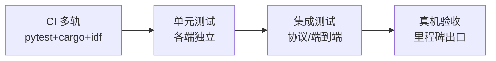

# BOSS PHONE 测试与验收方案

| 项目 | 内容 |
|---|---|
| 状态 | Draft v0.1 |
| 上游 | [BOSS_PHONE_PRD.md](BOSS_PHONE_PRD.md) §9 里程碑 · [README](../README.md) 验收清单 |
| 日期 | 2026-08-24 |

本文把 PRD 的里程碑出口标准展开成**可执行验收清单**与**真机测试矩阵**。遵循 AGENTS.md：`idf.py build` 是最小检查，硬件功能必须真机逐项验证并记录结果。

---

## 1. 测试分层

| 层 | 范围 | 环境 |
|---|---|---|
| 单元 | 协议编解码、seq 去重、分帧、路由决策、适配器解析 | 各端 CI |
| 集成 | 协议一致性（C/Rust/Python/Kotlin 互操作）、Hub↔插件、端↔Hub | 无板（虚拟 CDC + 模拟 Agent） |
| 真机验收 | 每个里程碑出口标准 | 真实硬件 + 真实 CLI |

---

## 2. CI 多轨

| 轨 | 触发 | 内容 |
|---|---|---|
| `ci-firmware` | push 到 `main` / PR | `idf.py build`（ESP-IDF 5.5.x），检查零 warning |
| `ci-rust` | 同 | `cargo test`（固件 Rust 业务层 workspace），协议一致性测试 |
| `ci-hub` | 同 | `pytest`（hub + plugins Python 包），协议一致性测试 |
| `ci-android` | 同（M3 起） | `./gradlew test assembleDebug` |

> 协议 Schema 变更必须四端生成物同步提交，否则 CI 失败（DESIGN_OVERVIEW §6）。

---

## 3. M1 验收清单（骨架版·USB）

| # | 项 | 操作 | 通过标准 |
|---|---|---|---|
| M1-1 | 分区与存储 | 烧录后 `hub doctor` | storage(LittleFS) 可读写，空间 3.9MB |
| M1-2 | USB 握手 | 插线开 Hub | hello/hello_ack 成功；CDC0 日志 + CDC1 协议并存 |
| M1-3 | 电话簿 | 注册 2 个模拟 Agent | 联系人头像+名称+绿灯显示，▲▼ 可切换 |
| M1-4 | 状态灯 | 推送 state 变化 | 绿→黄→红实时变化，无轮询 |
| M1-5 | 权限问答 | 下发含单选+多选+输入的 ask | 单选 OK 自动跳题；多选长按切题；输入长按 OK 语音 |
| M1-6 | 来电报警 | 下发 ring(red_alert) | 扬声器响铃 + 事件层全屏弹窗 + 阻塞摘要 |
| M1-7 | 备忘录 | 录音→回放→列表 | 录音落盘、回放正常、显示时长 |
| M1-8 | 亮度管理 | 设置页调亮度/息屏 | 背光变化；超时息屏；按键即亮；USB 常亮 |
| M1-9 | 端到端 | 真实 Claude Code 触发 PreToolUse | 板子批准 → 恢复执行（DESIGN_PLUGIN §4.2） |
| M1-10 | 内存 | 长跑 1h | 空闲堆 ≥15%，无泄漏增长 |

---

## 4. M2 验收清单（无线+语音）

| # | 项 | 通过标准 |
|---|---|---|
| M2-1 | WiFi 传输 | 离开 USB，局域网 WS 连上，状态刷新 <1s |
| M2-2 | 对讲 | 长按 OK 说话 → 接线员转写回显 → 意图路由正确 |
| M2-3 | 语音指令 | "喂，让小张跑测试" → 目标 Agent 收到任务 |
| M2-4 | 备忘录转写 | 录音同步 → STT 回填标题/正文 → 列表标"已转写" |
| M2-5 | 备忘派发 | 已转写备忘 → 派发 → 目标 Agent 收到任务，状态回写 |
| M2-6 | 遥测四面板 | Token/PC 资源/提交与 CI 实时刷新；CI 失败触发红灯+报警 |
| M2-7 | 接线员容错 | 无多模态模型时走 STT 两段式，功能不降级 |

---

## 5. M3 验收清单（户外+富终端）

| # | 项 | 通过标准 |
|---|---|---|
| M3-1 | BLE 网关 | 出门 WiFi 断开 → BLE 回连手机 → 消息双向可达 <3s |
| M3-2 | 推送唤醒 | 设备离网 → 云中继 → 厂商推送 → App 激活网关 → 板子收消息 |
| M3-3 | 三端联动 | 回家 WiFi 直连后手机零推送（抓包确认无中继流量） |
| M3-4 | 离线队列 | 全离线期间事件不丢；回连 sync 补收，去重无重复 |
| M3-5 | 富终端四屏 | App 触摸版电话簿/问答/来电/驾驶舱与板子同步操作 |
| M3-6 | web coding | App 文本对话指挥 Agent，流式回复渲染 |
| M3-7 | 先答先得 | 板子与 App 同 ask 双端竞答，后答端收到 answer_done |
| M3-8 | 电量 | 户外 BLE 模式日均 <10mA 实测记录 |

---

## 6. M4 验收清单（LTE 板）

| # | 项 | 通过标准 |
|---|---|---|
| M4-1 | transport_lte | 新板插 SIM 即用，hello 声明 `relay`+`lte` |
| M4-2 | 真人联系人 | type:human 走模块语音通道，UI 与 Agent 通话统一 |
| M4-3 | 老板子回归 | 老固件不受影响，协议只增不改验证 |

---

## 7. 真机硬件测试矩阵

> 每项记录结果到 PR（AGENTS.md 要求），含照片/截图。

| 硬件 | 测试项 | 覆盖里程碑 |
|---|---|---|
| 显示 | 亮度档位/息屏/来电点亮；无花屏、无残影 | M1 |
| 按键 | 短按/长按语义全表（PRD §6.1）；长按 ▲ 全局后退 | M1 |
| 音频 | 对讲回声/延迟；响铃音量；录音无爆音；音量控制 | M1/M2 |
| 电池 | 四档电源策略实测续航（全亮/低亮/息屏/深睡） | M1/M3 |
| USB | 双 CDC 并存；烧录仍可用；充电时屏幕常亮 | M1 |
| WiFi | 断线重连；外网故障时局域网直连不中断 | M2 |
| BLE | 配对绑定；自动回连；信号弱丢帧重传 | M3 |
| 存储 | 备忘录写满 3.9MB 行为；OTA 前后空间检查 | M1/M2 |

---

## 8. 回归与兼容测试

- **协议只增不改回归**：用 v1 固件连接 v2 Hub、v2 固件连接 v1 Hub，均须可用（hello 协商降级）。
- **内存回归**：每次固件改动跑空闲堆基线对比。
- **链路切换回归**：USB→WiFi→BLE→深睡往返，消息零丢失（seq 校验）。
- **双端并发回归**：板 + App 同时在线，ask 竞答、状态一致。

---

## 9. 无板开发环境

| 工具 | 用途 |
|---|---|
| `hub sim` | 模拟板子：虚拟 CDC + 脚本化收发，跑集成用例 |
| 模拟 Agent | 按插件协议回放 presence/state/ask，测 Hub 与 UI |
| `tools/pdf-export` | 文档回归（非功能） |
